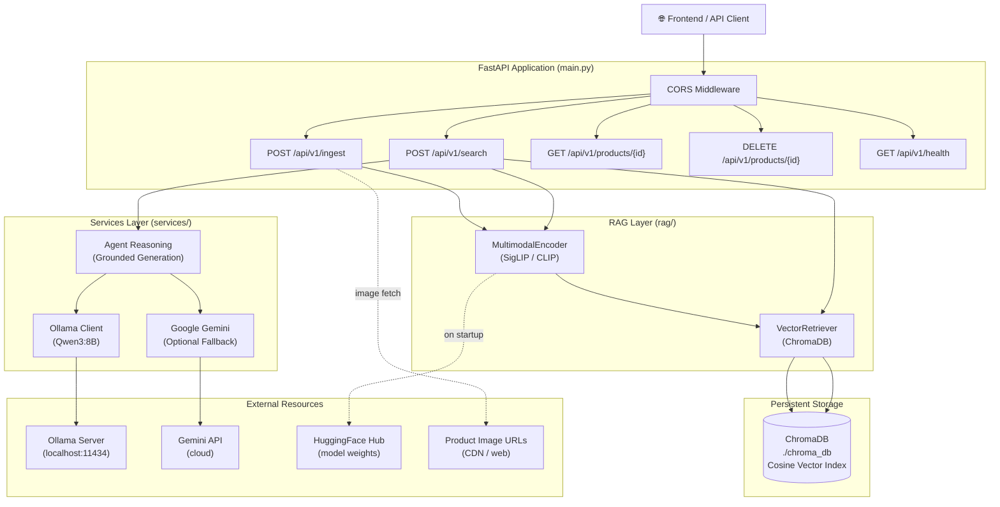

# 🛍️ UrbanPick — Backend Workflow Analysis

## 📁 Project Structure

```
backend/
├── main.py              # FastAPI application — all HTTP endpoints
├── config.py            # Pydantic Settings (env-driven configuration)
├── schemas.py           # Pydantic request/response models
├── catalog_seed.py      # One-shot CLI seeding & smoke-test script
├── requirements.txt     # Pinned Python dependencies
├── .env.example         # Environment variable template
├── chroma_db/           # Persistent ChromaDB vector store (on disk)
├── rag/
│   ├── encoder.py       # MultimodalEncoder — SigLIP / CLIP wrapper
│   └── retriever.py     # VectorRetriever — ChromaDB CRUD + ANN search
└── services/
    ├── ollama_client.py  # Thin HTTP wrapper around Ollama REST API
    └── agent_reasoning.py  # Grounded response generation (Ollama → Gemini → fallback)
```

---

## 🏗️ Architecture Overview



---

## 🔄 Core Workflows

### 1. Startup / Lifespan

```
App Start
  │
  ├─▶ MultimodalEncoder.__init__()
  │     ├─ Load SigLIP (google/siglip-base-patch16-224) from HuggingFace
  │     └─ Fallback → CLIP (openai/clip-vit-base-patch32) if SigLIP fails
  │
  ├─▶ VectorRetriever singleton (get_retriever())
  │     └─ PersistentClient → get_or_create_collection("products", cosine)
  │
  └─▶ check_ollama_health()
        ├─ GET /api/tags on Ollama server
        ├─ [OK] model ready ✅
        ├─ [WARN] Ollama up but model not pulled
        └─ [WARN] Ollama unreachable → graceful degradation
```

---

### 2. Product Ingestion Flow (`POST /api/v1/ingest`)

```
Client Request (JSON body)
  │
  ├─▶ [Auth] _verify_ingest_api_key() — checks X-Api-Key header
  │
  ├─▶ ProductIngestSchema validation (Pydantic)
  │     ├─ Rejects placeholders ("string", "null", "test", etc.)
  │     ├─ Validates price >= 0, rating 0–5, discount 0–100
  │     ├─ Validates image_url is HTTP/HTTPS
  │     └─ Auto-derives discount from original_price if missing
  │
  ├─▶ enc.encode_text(title + brand + category + price + specs)
  │     └─ SigLIP text tower → L2-normalized float[] vector
  │
  ├─▶ [Optional] fetch image_url via httpx (async, 10s timeout)
  │     └─ enc.encode_image(bytes) → L2-normalized float[] vector
  │
  ├─▶ Fuse embeddings
  │     ├─ BOTH: element-wise addition → re-normalize (L2) → "multimodal"
  │     └─ TEXT ONLY: text_vector → "text_only"
  │
  └─▶ retriever.add_product(metadata, joint_vector)
        └─ ChromaDB.upsert(id, embedding, metadata, document)
              └─ Returns: {status, product_id, embedding_type, vector_dimension, total_indexed}
```

---

### 3. Multimodal Search Flow (`POST /api/v1/search`)

```
Client Request (multipart/form-data)
  │  Fields: text_prompt?, image_file?, max_price?, category?, top_k?
  │
  ├─▶ Input validation (at least one of text_prompt OR image_file required)
  │
  ├─▶ [If text] enc.encode_text(text_prompt) → text_vector
  │
  ├─▶ [If image] _validate_image_upload(bytes, filename)
  │     ├─ Checks size <= MAX_IMAGE_SIZE_MB
  │     ├─ Checks extension in {jpg, jpeg, png, webp, gif, bmp}
  │     └─ enc.encode_image(bytes) → image_vector
  │
  ├─▶ Build query_vector
  │     ├─ text + image: fuse (add + re-normalize) → "multimodal"
  │     ├─ text only                                 → "text"
  │     └─ image only                                → "image"
  │
  ├─▶ retriever.retrieve(query_vector, top_k, max_price, category, query_text)
  │     ├─ Detect form-factor hints: "over-ear" / "in-ear / earbuds / TWS"
  │     ├─ Over-fetch: max(top_k × 5, 25) results from ChromaDB ANN
  │     ├─ Post-filter: price, category substring, form-factor keyword
  │     ├─ Score: similarity = clamp(1 - cosine_distance, 0, 1)
  │     └─ Return top_k products sorted by descending similarity
  │
  ├─▶ generate_grounded_response(user_query, retrieved_products)
  │     ├─ [1] Try Ollama (Qwen3:8B) — temperature=0.2
  │     │     ├─ Build context block from retrieved_products ONLY
  │     │     ├─ Strict system prompt: "no hallucination, output raw JSON"
  │     │     └─ Parse → {summary, comparison_table}
  │     ├─ [2] Try Gemini (if API key set) — same prompt
  │     └─ [3] Deterministic fallback (no LLM needed)
  │           └─ Echoes fields from retrieved_products, no invention
  │
  └─▶ SearchResponseSchema
        ├─ query
        ├─ recommended_products (list)
        ├─ ai_analysis (summary string)
        ├─ comparison_table (list of dicts)
        ├─ total_results
        └─ search_type ("text" | "image" | "multimodal")
```

---

### 4. LLM Reasoning Chain (`services/agent_reasoning.py`)

```
generate_grounded_response()
  │
  ├─ Priority 1: Ollama (local, always tried first)
  │     ollama_client.generate_text(prompt, system=SYSTEM_INSTRUCTIONS)
  │       ├─ POST /api/generate → Ollama REST
  │       ├─ model: qwen3:8b, temperature: 0.2, top_p: 0.9, stream: false
  │       └─ _parse_llm_json() strips markdown fences, validates keys
  │
  ├─ Priority 2: Gemini (cloud, optional fallback)
  │     google.generativeai.GenerativeModel.generate_content(prompt)
  │     └─ Same JSON parsing logic
  │
  └─ Priority 3: Deterministic template
        ├─ No LLM dependency
        ├─ Only echoes real data from retrieved_products
        └─ Safe for CI / testing without running AI services
```

---

## 📡 API Endpoints Summary

| Method | Path | Auth | Description |
|--------|------|------|-------------|
| `GET` | `/` | ❌ Open | Quick liveness + model status |
| `GET` | `/api/v1/health` | ❌ Open | Detailed health: Ollama, ChromaDB, Gemini |
| `POST` | `/api/v1/ingest` | 🔑 X-Api-Key | Upsert a product (validate → embed → store) |
| `GET` | `/api/v1/products/{id}` | ❌ Open | Fetch single product metadata |
| `DELETE` | `/api/v1/products/{id}` | 🔑 X-Api-Key | Remove a product from the index |
| `POST` | `/api/v1/search` | ❌ Open | Multimodal semantic search + AI reasoning |

> 🔑 Auth is optional in dev mode (INGEST_API_KEY left empty = open access).

---

## 🧩 Component Deep-Dive

### `MultimodalEncoder` ([encoder.py](file:///c:/Users/bopan/OneDrive/Desktop/PROJECT/ecommerce-ai-assistant/backend/rag/encoder.py))
- Uses **SigLIP** (`google/siglip-base-patch16-224`) as primary — a vision-language model with better zero-shot performance than CLIP
- **Falls back** to CLIP (`openai/clip-vit-base-patch32`) if SigLIP load fails
- Handles both `get_text_features()` and `get_image_features()` with multiple output shapes
- All output vectors are **L2-normalized** (unit sphere) — compatible with cosine similarity
- Runs inference in `torch.no_grad()` — memory efficient, no gradient graph

### `VectorRetriever` ([retriever.py](file:///c:/Users/bopan/OneDrive/Desktop/PROJECT/ecommerce-ai-assistant/backend/rag/retriever.py))
- **Cosine distance** HNSW index (`hnsw:space: cosine`) — optimal for normalized vectors
- **Over-fetch strategy**: fetches `max(top_k × 5, 25)` from ANN, then post-filters — prevents filter from leaving too few results
- **Form-factor guard**: detects "over-ear" / "in-ear / TWS" keywords in query and enforces it as a hard filter on title + specs
- **Serialization**: `store_availability` and `price_history` are JSON-stringified for ChromaDB (flat metadata only)
- **Singleton pattern**: module-level `_retriever` ensures one ChromaDB connection per process

### `agent_reasoning.py` ([agent_reasoning.py](file:///c:/Users/bopan/OneDrive/Desktop/PROJECT/ecommerce-ai-assistant/backend/services/agent_reasoning.py))
- **Hallucination control**: system prompt forbids the LLM from using any knowledge outside the retrieved product context
- **Strict JSON output**: structured `{summary, comparison_table}` — no prose leakage
- **Graceful degradation**: 3-tier fallback ensures the endpoint always returns a response
- **Low temperature** (0.2): keeps LLM deterministic for product comparisons

### `config.py` ([config.py](file:///c:/Users/bopan/OneDrive/Desktop/PROJECT/ecommerce-ai-assistant/backend/config.py))
- Uses **pydantic-settings** — clean, type-safe env loading
- `env_file=".env"` + `extra="ignore"` — safe against unknown env vars
- Single `settings` singleton imported everywhere — no scattered `os.getenv()` calls

---

## 🔍 Strengths

| Strength | Detail |
|----------|--------|
| **True multimodal RAG** | Image + text vectors fused at both ingest and query time |
| **Graceful degradation** | Ollama → Gemini → template fallback at every layer |
| **No hallucination by design** | LLM strictly grounded in retrieved context |
| **Upsert semantics** | Re-ingesting same `product_id` updates, never duplicates |
| **Form-factor awareness** | "over-ear" / "in-ear" query constraints enforced in retriever |
| **Clean config** | All env vars in one `Settings` class, never hardcoded |
| **Input validation** | Pydantic guards + placeholder rejection + image format checks |
| **Singleton patterns** | One encoder + one retriever per process — no redundant initialization |

---

## ⚠️ Issues & Gaps Found

### 🔴 Critical

| # | Issue | Location | Impact |
|---|-------|----------|--------|
| 1 | **`generate_grounded_response` is synchronous (blocking)** — runs in FastAPI's async event loop via a sync `httpx.Client` call | [`ollama_client.py:58`](file:///c:/Users/bopan/OneDrive/Desktop/PROJECT/ecommerce-ai-assistant/backend/services/ollama_client.py#L58) | Blocks the entire event loop for up to `OLLAMA_TIMEOUT=120s` per request |
| 2 | **`encode_text` and `encode_image` are synchronous** — PyTorch inference runs directly in the async request handler without `asyncio.run_in_executor` | [`main.py:276,468`](file:///c:/Users/bopan/OneDrive/Desktop/PROJECT/ecommerce-ai-assistant/backend/main.py#L276) | Stalls all concurrent requests during inference |

### 🟡 Moderate

| # | Issue | Location | Impact |
|---|-------|----------|--------|
| 3 | **No request-level caching** — identical queries re-embed and re-query every time | `main.py` | Wasteful CPU/GPU usage for repeated searches |
| 4 | **`pinecone-client` in requirements.txt but never used** | `requirements.txt:67` | Bloated venv (~100MB), potential confusion |
| 5 | **`VectorRetriever.clear()` has no auth protection** — dangerously exposed as a method | [`retriever.py:264`](file:///c:/Users/bopan/OneDrive/Desktop/PROJECT/ecommerce-ai-assistant/backend/rag/retriever.py#L264) | Any internal caller can wipe the entire index |
| 6 | **Image URL fetched synchronously at ingest but async at search** — inconsistency | `ingest_product` uses `httpx.AsyncClient` ✅, but encoder calls are sync | Design inconsistency |
| 7 | **`catalog_seed.py` hardcodes `BASE_URL=localhost:8000`** — not configurable | [`catalog_seed.py:20`](file:///c:/Users/bopan/OneDrive/Desktop/PROJECT/ecommerce-ai-assistant/backend/catalog_seed.py#L20) | Must edit file to run against staging/prod |

### 🟢 Minor

| # | Issue | Location |
|---|-------|----------|
| 8 | `score = 1 - cosine_distance` then clamped to [0,1] — ChromaDB cosine distance is already in [0,1] for unit vectors, the clamp is correct but the comment says [0,2] | `retriever.py:201` |
| 9 | No rate limiting on `POST /api/v1/search` — open endpoint | `main.py` |
| 10 | `check_ollama_health()` called synchronously at both startup and on every `GET /health` request | `ollama_client.py:80` |

---

## 💡 Recommendations

```
Priority  Recommendation
────────  ──────────────────────────────────────────────────────────────────
🔴 High   Wrap encoder calls + Ollama generate in asyncio.run_in_executor()
          or use a thread-pool (starlette.concurrency.run_in_threadpool)
          to avoid blocking the event loop.

🔴 High   Replace httpx.Client (sync) in ollama_client.generate_text()
          with httpx.AsyncClient and make the function async.

🟡 Med    Add a simple TTL/LRU cache on encode_text() — many queries
          repeat the same search terms.

🟡 Med    Remove pinecone-client from requirements.txt unless you plan
          to use it; it adds ~100 MB and misleads contributors.

🟡 Med    Accept BASE_URL as a CLI argument or env var in catalog_seed.py.

🟡 Med    Add rate limiting middleware (e.g., slowapi) to /api/v1/search.

🟢 Low    Expose VectorRetriever.clear() only through a protected admin
          endpoint (not as a public method).
```

---

## 📦 Tech Stack Summary

| Layer | Technology |
|-------|-----------|
| **Web framework** | FastAPI 0.141 + Uvicorn + Starlette |
| **Data validation** | Pydantic v2 + pydantic-settings |
| **Multimodal encoder** | HuggingFace Transformers (SigLIP → CLIP fallback) + PyTorch 2.13 |
| **Vector store** | ChromaDB 1.5.9 (persistent, HNSW cosine) |
| **Primary LLM** | Ollama (Qwen3:8B, local) |
| **Fallback LLM** | Google Gemini 2.0 Flash (cloud, optional) |
| **HTTP client** | httpx (async for image fetch, sync for Ollama) |
| **Image processing** | Pillow |
| **Seeding** | catalog_seed.py (8 real headphone products, smoke tests) |
